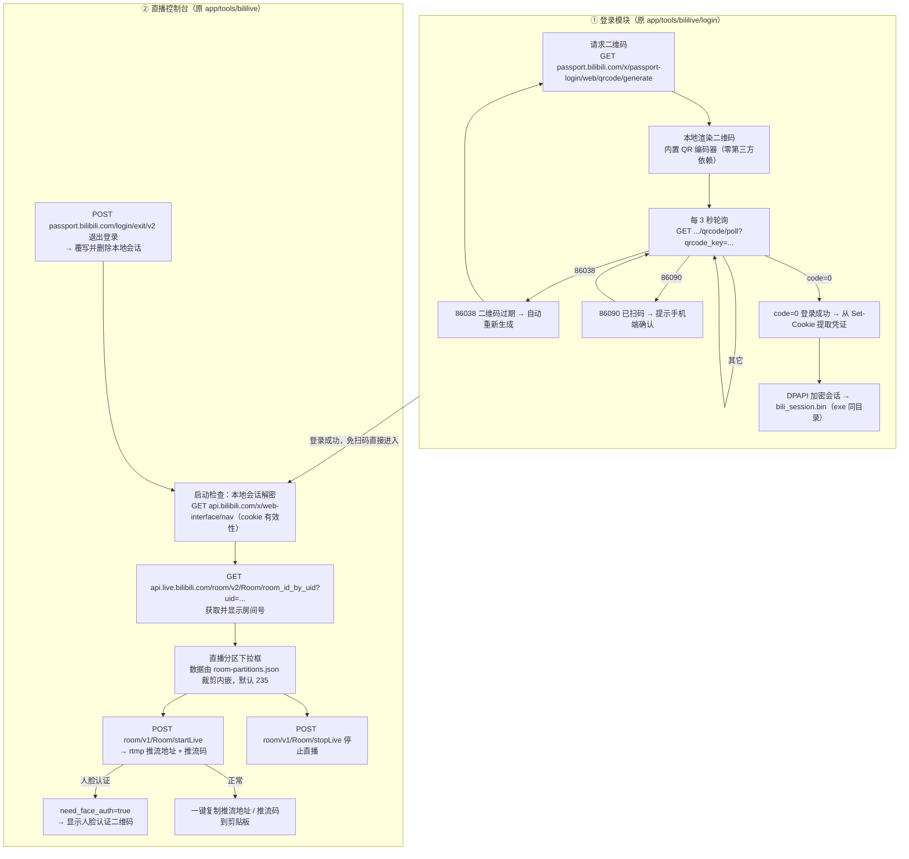
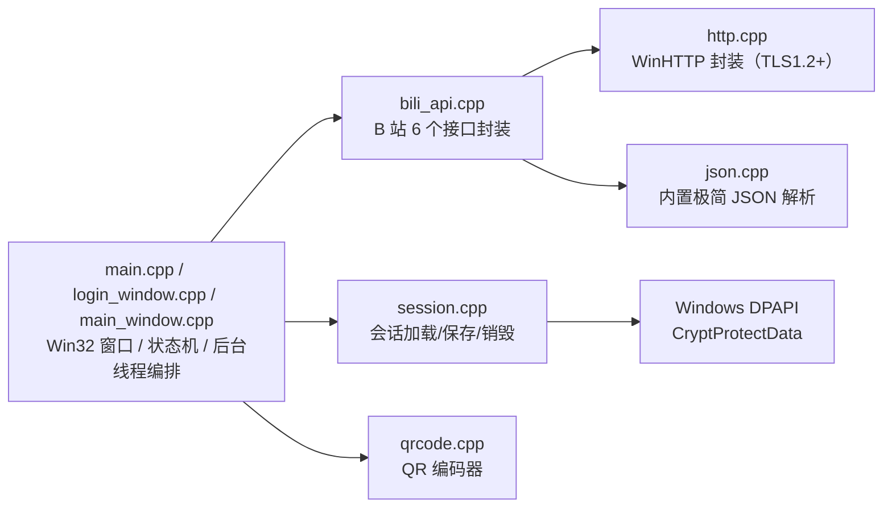
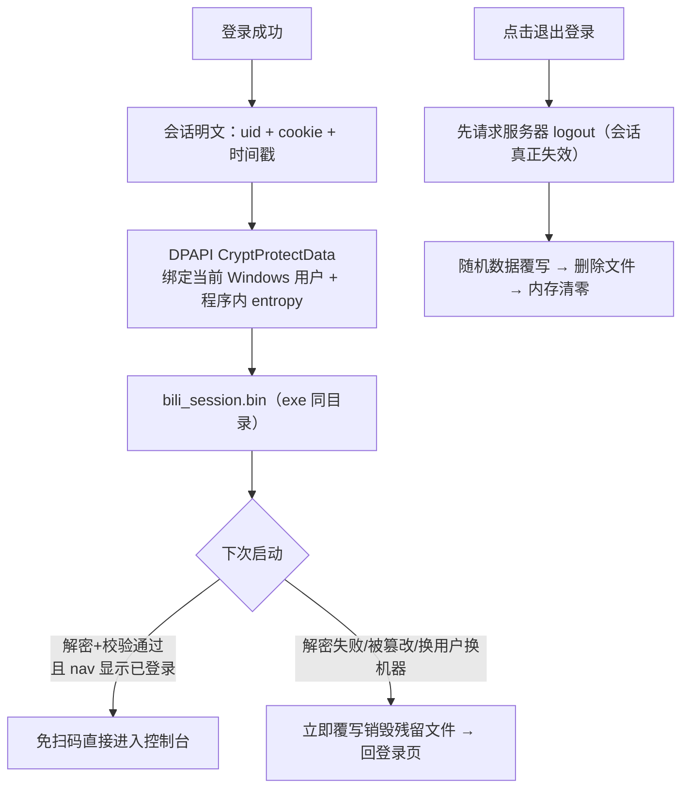
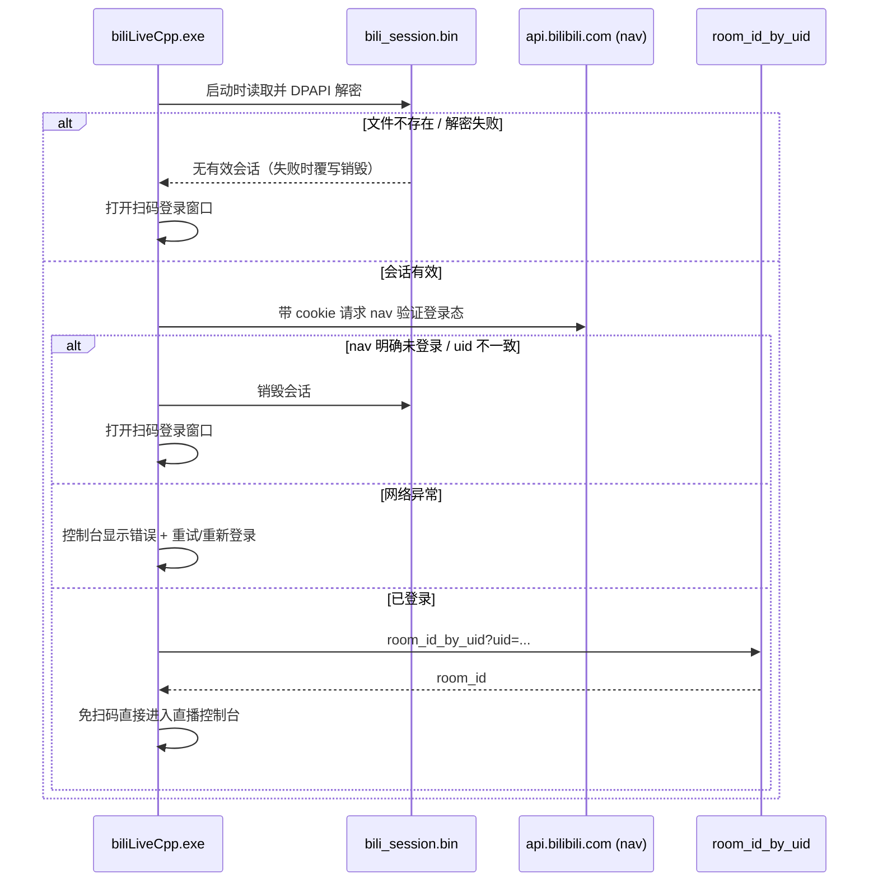

# BiliLive C++ (Win32) — 功能迁移总览

将 Next.js 站点中的「bilibili 直播工具」整体迁移为**纯 C++ / Win32** 桌面程序：

- 迁移来源：`app/tools/bililive/`（登录页 + 控制台页）与 `app/api/bili-proxy/`（6 个服务端代理接口）
- 目标形态：静态编译单 exe、零运行时依赖（不装 .NET / Node / Python）、Windows 专用
- 本地持久化：会话凭证与界面设置两个文件，均与主程序 exe **同目录**存放
- 界面语言：English / 简体中文，**默认英文**，右上角一键切换并记住偏好

---

## 一、功能总览图



## 二、网页版 → C++ 版 功能对照表

| # | 原实现（Next.js） | C++ Win32 实现 | 对应源文件 |
|---|---|---|---|
| 1 | `GET /api/bili-proxy/generate` 生成二维码 | 直连 `passport.bilibili.com/x/passport-login/web/qrcode/generate` | `src/bili_api.cpp` |
| 2 | `qrcode` npm 库 canvas 渲染二维码 | 内置 QR 编码器（Byte 模式 / ECC-M / 自动版本 / 全掩码评估） | `src/qrcode.cpp` |
| 3 | 每 3s `GET /api/bili-proxy/poll` 轮询 | 直连 poll 接口 + SetTimer(3000)，网络请求在后台线程 | `src/login_window.cpp` |
| 4 | 86038 过期自动刷新 / 86090 提示确认 | 状态机同源实现 | `src/login_window.cpp` |
| 5 | 登录成功由后端 `Set-Cookie` 转发给浏览器 | 从原始响应头解析 Set-Cookie，提取凭证 | `src/bili_api.cpp` |
| 6 | 浏览器 cookie（document.cookie）判断登录 | DPAPI 加密会话文件（exe 同目录） | `src/session.cpp` |
| 7 | `GET /api/bili-proxy/roomIdByUid` 获取房间号 | 直连 `api.live.bilibili.com/room/v2/Room/room_id_by_uid` | `src/bili_api.cpp` |
| 8 | 分区下拉框（引用 room-partitions.json） | 构建期由 `tools/gen_partitions.js` 裁剪生成 `src/partitions_data.h` | `src/partitions_data.h` |
| 9 | `POST /api/bili-proxy/startLive` 开始直播 | 直连 startLive（带 cookie + csrf_token） | `src/bili_api.cpp` |
| 10 | need_face_auth → 渲染人脸认证二维码 | 同源实现（复用二维码面板） | `src/main_window.cpp` |
| 11 | `POST /api/bili-proxy/stopLive` 停止直播 | 直连 stopLive | `src/bili_api.cpp` |
| 12 | 复制推流地址/推流码按钮 | 剪贴板 API（CF_UNICODETEXT） | `src/main_window.cpp` |
| 13 | `POST /api/bili-proxy/logout` 退出登录 + 清 cookie | 直连 logout + 覆写删除会话文件 | `src/bili_api.cpp` / `src/session.cpp` |
| 14 | 服务端 CSRF Origin 校验 / 限流 | 桌面端无需跨域代理；以按钮禁用防连点 | `src/main_window.cpp` |
| 15 | 无（新增） | **自动登录：会话有效则免扫码直进控制台** | `src/main_window.cpp` + `src/session.cpp` |
| 16 | 无（新增；bililive 页面本身未接入站点语言框架） | **中英双语界面，默认英文**：字符串表 + 模板渲染 + 语言偏好持久化 | `src/i18n.cpp` + `src/login_window.cpp` / `src/main_window.cpp` |

> 网页版必须经服务端代理的原因（B 站 WAF 校验 Origin、浏览器无法读跨域 Set-Cookie/CSRF Token）
> 在桌面端天然不存在：WinHTTP 可直接控制 Origin/Referer/Cookie 头并读取原始响应。

## 三、架构与数据流



## 四、本地文件与安全模型（重点）

**落盘文件**（均在 exe 同目录；程序不写注册表、不写 `%APPDATA%`、不写临时目录、不写日志文件）：

| 文件 | 内容 | 敏感性 |
|---|---|---|
| `bili_session.bin` | DPAPI 加密的登录凭证（uid + cookie），见下文安全设计 | 高（已加密） |
| `bili_settings.ini` | 界面语言偏好（纯文本 `lang=en` / `lang=zh`） | 无 |



保证「删除主 exe 与同目录缓存后，他人无法利用其它地方残留文件登录原账户」的关键设计：

1. **无副本**：凭证只存在于 exe 同目录的 `bili_session.bin`，不存在任何隐藏备份位置；删除该目录内容后，磁盘上不存在可用于登录的持久化数据。
2. **DPAPI 用户绑定加密**：即使有人抢先复制了 `bili_session.bin`，换 Windows 用户/换机器一律无法解密（`CryptUnprotectData` 直接失败）。
3. **篡改即销毁**：文件解密或完整性校验失败时，程序立即覆写并删除该文件，而不是当作未登录简单忽略（避免"坏文件复活"）。
4. **登出双保险**：先调 B 站 `login/exit/v2` 让服务器端会话失效，再以随机字节覆写文件后删除、清空进程内敏感内存（`SecureZeroMemory`）。
5. **失败即拒绝**：手动复制/伪造会话文件到程序目录时，uid 与 cookie 一致性、关键 cookie（SESSDATA / bili_jct / DedeUserID）缺一即判无效并销毁。

> 说明：程序运行中凭证不可避免地存在于进程内存；系统级崩溃转储等行为由 Windows 策略决定（默认对普通用户不开启完整转储），不在本程序可控范围。

## 五、自动登录流程（免扫码）



## 六、目录结构

```
bililive-cpp/
├── README.md               # 本文档（功能图表 + 安全模型）
├── app.manifest            # 清单：asInvoker + DPI 感知 + 系统兼容声明
├── app.rc                  # 资源脚本（内嵌 manifest）
├── build.bat               # 一键构建（自动探测 MSVC / MinGW）
├── build_mingw.bat         # MinGW-w64 静态构建 → build\BiliLiveCpp.exe
├── build_msvc.bat          # MSVC 构建 → build\msvc\BiliLiveCpp.exe
├── src/
│   ├── app.h               # 公共消息/载荷定义
│   ├── main.cpp            # WinMain、窗口注册、状态机、自检(--selftest)/QR 调试(--qr-dump)
│   ├── login_window.cpp    # 扫码登录窗口（二维码展示 + 轮询状态机）
│   ├── main_window.cpp     # 直播控制台窗口（房间号/分区/开播/停播/推流复制/人脸认证/登出）
│   ├── bili_api.h/.cpp     # B 站 6 接口 + Set-Cookie 解析
│   ├── http.h/.cpp         # WinHTTP 封装（TLS1.2 / 原始响应头读取）
│   ├── json.h/.cpp         # 极简 JSON 解析（含 \uXXXX 与代理对）
│   ├── qrcode.h/.cpp       # QR 编码器（Byte 模式 / v1-40 / 全掩码评估）
│   ├── session.h/.cpp      # DPAPI 会话存储 / 完整性校验 / 覆写销毁
│   ├── util.h/.cpp         # UTF 转换 / URL 编码 / 剪贴板等工具
│   ├── i18n.h/.cpp         # 多语言：en/zh 字符串表 + 模板渲染 + 偏好持久化
│   └── partitions_data.h   # 由 tools/gen_partitions.js 生成（构建期裁剪）
└── tools/
    ├── gen_partitions.js   # 裁剪 room-partitions.json → partitions_data.h
    ├── verify_qr.js        # 与 npm qrcode 库交叉验证编码器（可选 jsQR 解码验证）
    └── lang_smoke.ps1      # 多语言 GUI 冒烟测试（切换即时生效 + 重启持久化）
```

## 七、构建

两种工具链任选其一，均产出**无运行时依赖**的单文件 exe：

- **MinGW-w64（MSYS2，已验证）**：运行 `build_mingw.bat`，产物 `build\BiliLiveCpp.exe`
  - 脚本会先把 `C:\msys64\mingw64\bin` 前置到 PATH（`cc1plus` 依赖同目录 DLL，否则会静默失败）
  - 关键编译参数：`-std=c++17 -O2 -mwindows -static -static-libgcc -static-libstdc++ -Wall -Wextra`
  - 链接库：`winhttp bcrypt crypt32 gdi32 user32 ole32 shell32 comctl32`
- **MSVC 2022**：在「x64 Native Tools Command Prompt」中运行 `build_msvc.bat`，产物 `build\msvc\BiliLiveCpp.exe`
  - 关键参数：`/std:c++17 /O2 /EHsc /utf-8 /W4 /DUNICODE /D_UNICODE`，`/SUBSYSTEM:WINDOWS`

`build.bat` 为便捷入口：检测到 `cl.exe` 时走 MSVC，否则回退 MinGW。

## 八、验证与自检

1. **程序自检**（会话安全 / 工具函数 / QR 编码器 / 多语言内置用例）：
   ```
   build\BiliLiveCpp.exe --selftest build\selftest_result.txt
   ```
   覆盖 29 项检查：会话保存-加载往返、篡改检测与销毁、密钥缺失拒绝、UTF/URL 工具、二维码内置用例、
   en/zh 字符串表完整性（编译期 static_assert + 运行时校验）、模板占位符渲染、语言设置保存/读取往返等；
   全部通过时输出 `ALL PASS`（返回码 0）。
2. **QR 编码器交叉验证**（与 npm `qrcode` 库逐模块比对，22 个用例）：
   ```
   node tools\verify_qr.js
   ```
   三层策略：① 版本选择一致；② 强制同 version+mask 后矩阵逐位一致（数据编码/RS 纠错/交织/格式位全覆盖）；
   ③ 自动掩码选择差异仅记录 INFO（两库对规范 N3/N4 penalty 的实现细则不同，均合法可解码）。
   若已安装可选的 `jsqr` 解码器，会追加端到端解码验证（渲染位图 → 解码 → 比对原文）。
   全部通过时输出 `RESULT: ALL 22 CASES PASS`。
3. **多语言 GUI 冒烟测试**（可选，Windows PowerShell）：
   ```
   powershell -NoProfile -ExecutionPolicy Bypass -File tools\lang_smoke.ps1
   ```
   自动完成：无设置文件启动（默认英文）→ 点击「中文」→ 重启验证持久化 → 点击「English」切回；
   全部通过时输出 `RESULT: SMOKE PASS`（脚本结束后恢复原设置文件内容）。

## 九、使用

1. 双击 `BiliLiveCpp.exe`
2. 首次使用：用哔哩哔哩 App 扫描窗口中的二维码 → 手机端确认 → 自动进入控制台
3. 已在有效登录态：直接进入控制台（无可扫码步骤）
4. 控制台：选择分区 → 开始直播 → 复制推流地址/推流码到 OBS；停止直播同理
5. 点击「退出登录」：服务器端会话失效 + 本地凭证销毁
6. 语言切换：两个窗口右上角均有语言按钮（默认 English，显示目标语言本名）；切换立即生效并写入
   `bili_settings.ini`，下次启动沿用；无设置文件或值非法时回退默认英文

> `bili_session.bin`（登录凭证）与 `bili_settings.ini`（语言偏好）均与 exe 同目录；迁移程序时请连同 exe
> 一起移动（会话同一 Windows 用户下仍有效）。删除 exe 与该目录文件即可完全清除所有本地痕迹。
